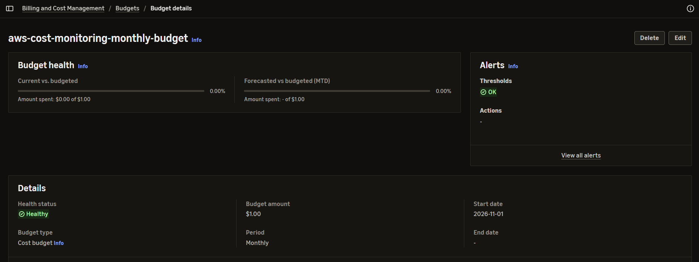

# AWS Cost Monitoring and Alerting using Terraform

## Overview

This project provisions an automated AWS cost monitoring and alerting solution using Terraform.

It helps monitor estimated AWS spending, configure monthly budgets, and notify the resource owner when spending exceeds predefined thresholds.

The infrastructure is provisioned as code, making it reusable and easy to deploy in another AWS account using the user's own AWS credentials and configuration.

## Architecture

The project uses the following AWS services and tools:

- **AWS Budgets** – Tracks monthly AWS spending against a configurable budget.
- **Amazon SNS** – Sends email notifications when budget thresholds are exceeded.
- **Amazon CloudWatch** – Monitors estimated AWS charges and triggers a billing alarm.
- **Terraform** – Provisions and manages AWS infrastructure as code.
- **AWS CLI** – Provides a script to list currently running EC2 instances.

### Alert Configuration

| Alert | Threshold | Notification |
|---|---:|---|
| AWS Budget Alert | 80% | SNS email |
| AWS Budget Alert | 100% | SNS email |
| CloudWatch Billing Alarm | Configurable monthly budget amount | SNS notification |

The default monthly budget is **$1 USD**. This can be changed through Terraform variables.

## Project Structure

```text
aws-cost-monitoring-terraform/
│
├── terraform/
│   ├── main.tf
│   ├── providers.tf
│   ├── variables.tf
│   ├── outputs.tf
│   ├── terraform.tfvars.example
│   └── .terraform.lock.hcl
│
├── scripts/
│   └── list-running-ec2.bat
│
├── screenshots/
│   ├── aws-monthly-budget.png
│   └── cost-allocation-tags.png
│
├── .gitignore
└── README.md
```

## Prerequisites

Before deploying, ensure you have:

- An AWS account.
- AWS CLI installed and configured.
- Terraform installed (version 1.5.0 or later).
- Appropriate AWS IAM permissions to create and manage the required resources.
- An email address for receiving notifications.

## Deployment Instructions

### 1. Clone the repository

```bash
git clone https://github.com/Dhrumil1608/aws-cost-monitoring-terraform.git
cd aws-cost-monitoring-terraform
```

### 2. Configure AWS credentials

Configure your AWS CLI credentials:

```bash
aws configure
```

Use your own AWS access credentials and preferred default region.

### 3. Configure Terraform variables

Navigate to the Terraform directory:

```bash
cd terraform
```

Copy the example configuration:

**Windows Command Prompt:**
```cmd
copy terraform.tfvars.example terraform.tfvars
```

**Linux/macOS:**
```bash
cp terraform.tfvars.example terraform.tfvars
```

Update `terraform.tfvars` with your own:

- AWS region
- Project name
- Environment
- Owner
- Notification email
- Monthly budget

The actual `terraform.tfvars` file is excluded from Git.

### 4. Initialize Terraform

```bash
terraform init
```

### 5. Format and validate the configuration

```bash
terraform fmt
terraform validate
```

### 6. Review the deployment plan

```bash
terraform plan
```

Review the proposed infrastructure changes before proceeding.

### 7. Deploy the infrastructure

```bash
terraform apply
```

Review the proposed changes and enter `yes` when prompted to confirm deployment.

### 8. Confirm the SNS email subscription

Check your email inbox for the Amazon SNS subscription confirmation message.

Open the confirmation link to activate the email subscription and start receiving notifications.

## AWS Billing Configuration

CloudWatch billing metrics require billing alerts to be enabled in AWS Billing preferences.

The AWS Billing `EstimatedCharges` metric is available in **US East (N. Virginia), us-east-1**. Therefore, the Terraform provider for this project defaults to `us-east-1`.

For cost allocation reporting, activate the `Project`, `Environment`, and `Owner` user-defined cost allocation tags in AWS Billing and Cost Management.

## EC2 Inventory Script

The repository includes a Windows batch script:

```text
scripts/list-running-ec2.bat
```

The script uses the AWS CLI to list running EC2 instances in the AWS CLI's configured default region.

It displays:

- Instance ID
- Instance Name
- Instance Type
- Public IP
- Private IP
- Instance State
- Availability Zone

Run the script from Windows Command Prompt after configuring AWS CLI credentials:

```cmd
scripts\list-running-ec2.bat
```

## Resource Tagging

The project applies the following tags to its AWS resources:

| Tag | Purpose |
|---|---|
| Project | Identifies the project |
| Environment | Identifies the environment |
| Owner | Identifies the resource owner |

These tags help organise and identify AWS resources.

## Screenshots

### AWS Monthly Budget



### Activated Cost Allocation Tags


## Important Notes

- AWS Budgets provides spending alerts; it does not automatically stop or terminate resources.
- CloudWatch billing metrics require billing alerts to be enabled in AWS Billing preferences.
- Billing metrics are available in the US East (N. Virginia) region.
- SNS email subscriptions must be confirmed before notifications can be delivered.
- AWS billing data and cost allocation reporting may have a delay.
- The actual `terraform.tfvars` file and Terraform state files are excluded from Git to protect sensitive configuration.
- The `.terraform.lock.hcl` file is included to maintain consistent provider versions.

## Technologies Used

- Amazon Web Services (AWS)
- Terraform
- AWS CLI
- Amazon SNS
- AWS Budgets
- Amazon CloudWatch
- Git and GitHub