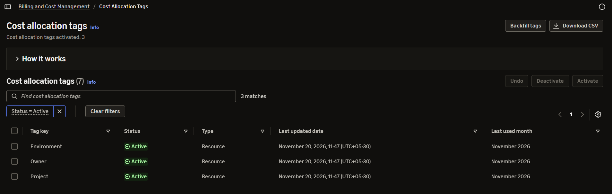

# AWS Cost Monitoring and Alerting using Terraform

## Overview

This project provisions an automated AWS cost monitoring and alerting solution using Terraform.

It monitors estimated AWS spending, configures monthly budgets, and sends email notifications when spending exceeds predefined thresholds.

The infrastructure is provisioned as code, making it reusable and configurable for different AWS accounts.

## Architecture

The project uses the following AWS services and tools:

- **AWS Budgets** – Tracks monthly AWS spending against a configurable budget.
- **Amazon SNS** – Delivers email notifications for budget and CloudWatch alerts.
- **Amazon CloudWatch** – Monitors estimated AWS charges and triggers a billing alarm.
- **AWS IAM / Service Principals** – Controls which AWS services can publish notifications to the SNS topic.
- **Terraform** – Provisions and manages AWS infrastructure as code.
- **AWS CLI** – Provides commands to manage and test the deployed infrastructure.

### Architecture Flow

```text
                    AWS Budgets
                  (80% and 100%)
                        |
                        |
                        v
                 Amazon SNS Topic
                        ^
                        |
                        |
                  CloudWatch Alarm
                  (EstimatedCharges)
                        |
                        v
                  Email Notification
                        |
                        v
                   User Inbox
```

Both AWS Budgets and CloudWatch publish notifications to the same SNS topic.

The SNS topic policy explicitly authorizes:
- `budgets.amazonaws.com`
- `cloudwatch.amazonaws.com`

The CloudWatch permission is restricted to the configured AWS account and billing alarm.

### Alert Configuration

| Alert | Threshold | Notification |
|---|---:|---|
| AWS Budget Alert | 80% | SNS email |
| AWS Budget Alert | 100% | SNS email |
| CloudWatch Billing Alarm | Configurable monthly budget | SNS email |

The example monthly budget is **$1 USD**. Both the budget amount and notification thresholds can be configured through Terraform variables.

## Project Structure

```text
aws-cost-monitoring-terraform/
│
├── terraform/
│   ├── main.tf
│   ├── providers.tf
│   ├── variables.tf
│   ├── outputs.tf
│   ├── terraform.tfvars.example
│   └── .terraform.lock.hcl
│
├── scripts/
│   └── list-running-ec2.bat
│
├── screenshots/
│   ├── aws-monthly-budget.png
│   └── cost-allocation-tags.png
│
├── .gitignore
└── README.md
```

## Prerequisites

Before deploying, ensure you have:

- An AWS account.
- AWS CLI installed and configured.
- Terraform installed (version 1.5.0 or later).
- Appropriate AWS IAM permissions to create and manage the required resources.
- An email address for receiving notifications.
- AWS Billing alerts enabled.

## AWS Account and Provider Configuration

Terraform uses an explicitly configured AWS CLI profile.

The provider configuration includes:

- `aws_region` – AWS deployment region.
- `aws_profile` – AWS CLI profile used by Terraform.
- `allowed_account_ids` – AWS account IDs Terraform is permitted to manage.

The `allowed_account_ids` setting provides an additional safeguard against accidentally deploying resources into an unintended AWS account.

### Region Validation

AWS Billing `EstimatedCharges` metrics are available only in **US East (N. Virginia), `us-east-1`**.

The Terraform configuration validates the region variable and rejects other regions.

## Deployment Instructions

### 1. Clone the repository

```bash
git clone https://github.com/Dhrumil1608/aws-cost-monitoring-terraform.git
cd aws-cost-monitoring-terraform
```

### 2. Configure an AWS CLI profile

Configure your AWS credentials using a named profile:

```bash
aws configure --profile my-aws-profile
```

Verify the identity associated with the profile:

```bash
aws sts get-caller-identity --profile my-aws-profile
```

Use the returned 12-digit AWS account ID in the Terraform configuration.

### 3. Configure Terraform variables

Navigate to the Terraform directory:

```bash
cd terraform
```

Copy the example configuration.

**Windows Command Prompt:**

```cmd
copy terraform.tfvars.example terraform.tfvars
```

**Linux/macOS:**

```bash
cp terraform.tfvars.example terraform.tfvars
```

Update `terraform.tfvars` with your own configuration:

```hcl
aws_region          = "us-east-1"
aws_profile         = "my-aws-profile"
allowed_account_ids = ["YOUR_AWS_ACCOUNT_ID"]

project_name        = "aws-cost-monitoring"
environment         = "personal"
owner               = "YOUR_NAME"

notification_email  = "YOUR_EMAIL_ADDRESS"

monthly_budget      = 1
budget_thresholds   = [80, 100]
```

Replace the example profile, account ID, owner, and email with your own values.

### 4. Initialize Terraform

```bash
terraform init
```

### 5. Format and validate the configuration

```bash
terraform fmt
terraform validate
```

### 6. Review the deployment plan

```bash
terraform plan
```

Review the proposed infrastructure changes before proceeding.

### 7. Deploy the infrastructure

```bash
terraform apply
```

Review the proposed changes and enter `yes` when prompted to confirm deployment.

### 8. Confirm the SNS email subscription

Check your email inbox for the Amazon SNS subscription confirmation message.

Open the confirmation link to activate the subscription.

Notifications will only be delivered to confirmed email subscriptions.

## AWS Resources Provisioned

| Resource | Purpose |
|---|---|
| SNS Topic | Central notification destination |
| SNS Topic Policy | Allows AWS Budgets and CloudWatch to publish |
| SNS Email Subscription | Delivers notifications by email |
| AWS Monthly Budget | Tracks monthly AWS spending |
| CloudWatch Billing Alarm | Monitors estimated AWS charges |

### AWS Budget

The monthly budget uses:

- Budget type: COST
- Time unit: MONTHLY
- Currency: USD
- Configurable spending limit
- Actual spending notifications at configurable percentage thresholds

### CloudWatch Billing Alarm

The CloudWatch alarm monitors:

- Namespace: `AWS/Billing`
- Metric: `EstimatedCharges`
- Dimension: `Currency = USD`
- Statistic: Maximum
- Period: 21,600 seconds
- Comparison: GreaterThanThreshold
- Threshold: Configurable monthly budget

The alarm sends notifications to the configured SNS topic when estimated charges exceed the specified threshold.

## Testing Notifications

After deployment and confirmation of the SNS email subscription, the CloudWatch notification integration can be tested using the AWS CLI.

Trigger the alarm:

```bash
aws cloudwatch set-alarm-state \
  --alarm-name "aws-cost-monitoring-billing-alarm" \
  --state-value ALARM \
  --state-reason "Testing SNS notification" \
  --region us-east-1 \
  --profile my-aws-profile
```

Check alarm action history:

```bash
aws cloudwatch describe-alarm-history \
  --alarm-name "aws-cost-monitoring-billing-alarm" \
  --history-item-type Action \
  --max-records 10 \
  --region us-east-1 \
  --profile my-aws-profile
```

Verify that the SNS action was successfully executed and check the subscribed email inbox.

Restore the alarm to its normal state:

```bash
aws cloudwatch set-alarm-state \
  --alarm-name "aws-cost-monitoring-billing-alarm" \
  --state-value OK \
  --state-reason "Restoring normal state after notification test" \
  --region us-east-1 \
  --profile my-aws-profile
```

Verify the alarm state:

```bash
aws cloudwatch describe-alarms \
  --alarm-names "aws-cost-monitoring-billing-alarm" \
  --query "MetricAlarms[0].StateValue" \
  --region us-east-1 \
  --profile my-aws-profile \
  --output text
```

Expected output:

```text
OK
```

Note: `set-alarm-state` temporarily changes the alarm state. CloudWatch can recalculate the state during its next metric evaluation.

## EC2 Inventory Script

The repository includes a Windows batch script:

```text
scripts/list-running-ec2.bat
```

The script uses AWS CLI to list currently running EC2 instances.

It displays:

- Instance ID
- Instance Name
- Instance Type
- Public IP
- Private IP
- Instance State
- Availability Zone

Run the script from Windows Command Prompt after configuring AWS CLI credentials:

```cmd
scripts\list-running-ec2.bat
```

## Resource Tagging

The project applies the following tags to its AWS resources:

| Tag | Purpose |
|---|---|
| Project | Identifies the project |
| Environment | Identifies the environment |
| Owner | Identifies the resource owner |

These tags help organise and identify AWS resources and support cost allocation reporting when activated in AWS Billing.

## Screenshots

### AWS Monthly Budget


### Activated Cost Allocation Tags



## Security and Repository Practices

- AWS credentials are managed through named AWS CLI profiles.
- The Terraform provider restricts deployment to explicitly allowed AWS account IDs.
- The AWS Billing region is validated as `us-east-1`.
- SNS topic permissions are explicitly configured for AWS Budgets and CloudWatch.
- The actual `terraform.tfvars` file is excluded from Git.
- Terraform state files are excluded from Git.
- Terraform plan files and local backup files are excluded from Git.
- The `.terraform.lock.hcl` file is included to maintain consistent provider versions.

## Important Notes

- AWS Budgets provides spending alerts; it does not automatically stop or terminate resources.
- CloudWatch billing metrics require billing alerts to be enabled in AWS Billing preferences.
- Billing metrics are available in the US East (N. Virginia) region.
- SNS email subscriptions must be confirmed before notifications can be delivered.
- AWS billing data and cost allocation reporting may have a delay.
- Estimated charges may differ from the final billed amount.
- Terraform resources should be reviewed using `terraform plan` before applying changes.

## Technologies Used

- Amazon Web Services (AWS)
- Terraform
- AWS CLI
- Amazon SNS
- AWS Budgets
- Amazon CloudWatch
- Git and GitHub
